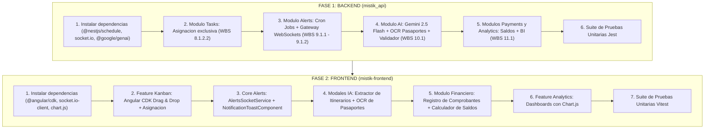

# Plan Maestro de Desarrollo: Semana 10 (Hito 100% Funcionalidad)

**Proyecto:** Sistema Web de Gestion Operativa, Comercial y Consular - MISTIK TOURS & TRAVEL S.A.C.  
**Corte Academico:** Semana 10 (Hito de Desarrollo Tecnologico - 100% Funcionalidad del Software segun Silabo UPN)  
**Estrategia:** Aceleracion Fast-Track Ultra (Cierre integral de desarrollo en Semana 10)  
**Documentos Hijos:**  
- Backend: [plan_sem10_backend.md](file:///D:/Proyectos/UPN/CAPSTONE/Sem10%20-%20T2/docs/plan_sem10_backend.md)  
- Frontend: [plan_sem10_frontend.md](file:///D:/Proyectos/UPN/CAPSTONE/Sem10%20-%20T2/docs/plan_sem10_frontend.md)

---

## 1. Proposito y Alcance

El presente plan establece la hoja de ruta tecnica integral para completar el 100% de las funcionalidades del software durante la **Semana 10**. Esta meta responde al compromiso asumido en el cronograma acelerado y al requerimiento del silabo de Practica de Campo de la Universidad Privada del Norte (UPN), permitiendo dejar el sistema completamente construido y probado localmente, listo para su despliegue cloud en la Semana 11 y pruebas UAT en la Semana 12.

La ejecucion se divide estrictamente en dos fases secuenciales:
1. **Fase 1: Implementacion Backend en `mistik_api` (Prioridad Inmediata)**.
2. **Fase 2: Implementacion Frontend en `mistik-frontend`**.

---

## 2. Matriz de Trazabilidad Integral (WBS vs Backend vs Frontend)

| Componente EDT | Codigo WBS | Entregable Canónico | Backend (`mistik_api`) | Frontend (`mistik-frontend`) | Criterio de Aceptacion |
| :--- | :---: | :--- | :--- | :--- | :--- |
| **Comp. 8: Tablero Kanban** | `8.1.1.1` - `8.1.2.1` | Tablero de 4 Columnas con Drag & Drop | `GET /api/v1/tasks`, `PATCH /api/v1/tasks/:id/status` | `KanbanBoardComponent` con Angular CDK (`cdkDropListGroup`) | Arrastre fluido entre columnas; limites WIP visuales (3 en Progreso, 2 en Revision). |
| | `8.1.2.2` | Control de Asignacion Exclusiva | `PATCH /api/v1/tasks/:id/assign`, `AssignTaskDto` | Selector en `TaskCardComponent` y validacion previa a arrastrar | No se permite mover una tarjeta a Progreso si no tiene responsable asignado. |
| **Comp. 9: Alertas y Cron Jobs** | `9.1.1.1` | Cron Job de Check-ins (24-48h) | `AlertsCronService` (`@Cron('0 */30 * * * *')`) | Evento WebSocket `alert:checkin-due` | Detecta vuelos proximos y emite recordatorio automatico. |
| | `9.1.1.2` | Cron Job de Citas Consulares | `AlertsCronService` (`@Cron('0 0 8 * * *')`) | Evento WebSocket `alert:visa-appointment` | Emite alertas escalonadas a 30, 15 y 7 dias de la cita. |
| | `9.1.2.1` - `9.1.2.3` | Gateway WebSockets y Toasts | `AlertsGateway` (Socket.io `/alerts`) | `AlertsSocketService` y `NotificationToastComponent` | Alertas flotantes en tiempo real con autodestruccion tras 8s. |
| **Comp. 10: Inteligencia Artificial** | `10.1.1.1` - `10.1.1.3` | Parser NLP de Correos de Reserva | `POST /api/v1/ai/parse-itinerary` con Gemini 2.5 Flash | `ItineraryParserModalComponent` | Extrae PNR, aerolinea, fechas, pasajeros y monto en JSON estructurado. |
| | `10.1.2.1` - `10.1.2.3` | OCR de Pasaportes y Alerta < 6 Meses | `POST /api/v1/ai/ocr-passport`, `PassportValidatorService` | `PassportOcrModalComponent` con badge de alerta critica | Alerta preventiva roja y advertencia consular si vigencia es menor a 6 meses. |
| **Comp. 11: Finanzas y Dashboards** | `11.1.1.1` - `11.1.1.3` | Pagos con Drive y Calculador de Saldos | `POST /api/v1/bookings/:id/payments`, `GET /.../balance` | `PaymentFormModalComponent`, `BalanceSummaryComponent` | Valida enlaces `https://drive.google.com/...` y recalcula saldo pendiente reactivamente. |
| | `11.1.2.1` - `11.1.2.3` | BI Financiero, Cuellos de Botella y Visas | `GET /api/v1/analytics/*` (3 endpoints) | `AnalyticsDashboardComponent` con Chart.js | Graficos de ingresos, embudo de conversion consular y tiempos de ciclo Kanban. |

---

## 3. Secuencia de Ejecucion Tecnica

---

## 4. Contratos de Comunicacion Backend - Frontend

### 4.1 Endpoints REST (`mistik_api` -> `mistik-frontend`)
1. `GET /api/v1/tasks`: Lista tareas operativas con relaciones `assignedTo`, `booking`, `visaProcess`.
2. `PATCH /api/v1/tasks/:id/status`: Actualiza estado de tarjeta (`status: TaskStatus`).
3. `PATCH /api/v1/tasks/:id/assign`: Asigna responsable unico (`assignedToId: UUID`).
4. `POST /api/v1/ai/parse-itinerary`: Procesa texto plano de correo con Gemini y retorna JSON estructurado.
5. `POST /api/v1/ai/ocr-passport`: Procesa imagen Base64 y retorna datos + validacion de vigencia.
6. `POST /api/v1/bookings/:id/payments`: Registra comprobante de pago con URL a Google Drive.
7. `GET /api/v1/bookings/:id/balance`: Retorna monto total, total pagado, saldo deudor y estado de liquidacion.
8. `GET /api/v1/analytics/financial-summary`: Metricas de ingresos devengados vs cobrados.
9. `GET /api/v1/analytics/visa-conversion`: Conteo de expedientes por fase consular.
10. `GET /api/v1/analytics/kanban-bottlenecks`: Lead time, cycle time y saturacion de limites WIP.

### 4.2 Eventos WebSockets (Namespace `/alerts`)
- Emision del Servidor:
  - `alert:checkin-due`: Datos del vuelo proximo (24h a 48h), PNR y nombre del pasajero.
  - `alert:visa-appointment`: Datos de la cita consular (30d, 15d, 7d), postulante y fecha programada.
  - `task:status-changed`: Notificacion en tiempo real de transicion de tarjeta Kanban.

---

## 5. Definicion de Hecho (Definition of Done - DoD)

Para considerar culminada la Semana 10 y alcanzar el **100% de funcionalidad del software**, deben cumplirse las siguientes condiciones objetivas:

1. **Backend Completo:**
   - Todos los 10 endpoints REST responden con codigo HTTP 200/201 ante payloads validos y 400/404 ante errores esperados.
   - Los Cron Jobs ejecutan sus rutinas sin desbordamientos de memoria.
   - El Gateway WebSockets emite y recibe eventos en tiempo real.
   - Pruebas unitarias de backend ejecutadas satisfactoriamente con Jest.

2. **Frontend Completo:**
   - Tablero Kanban interactivo con drag-and-drop y bloqueo de transicion a Progreso si no hay responsable asignado.
   - Notificaciones toast flotantes visualizadas al recibir eventos WebSockets.
   - Modales de IA (itinerarios y OCR) integrados, mostrando la advertencia visual si la vigencia es menor a 6 meses.
   - Modulo de pagos recalculando saldos deudores y validando enlaces a Google Drive.
   - Dashboards de BI renderizando graficos interactivos con Chart.js.
   - Pruebas unitarias de frontend ejecutadas satisfactoriamente con Vitest.

3. **Normas de Codigo y Calidad:**
   - Codigo fuente libre de errores de tipado en TypeScript.
   - Comentarios de codigo y documentacion en espanol neutro directo sin tildes ni emojis.
   - Commits individuales respetando Conventional Commits.
